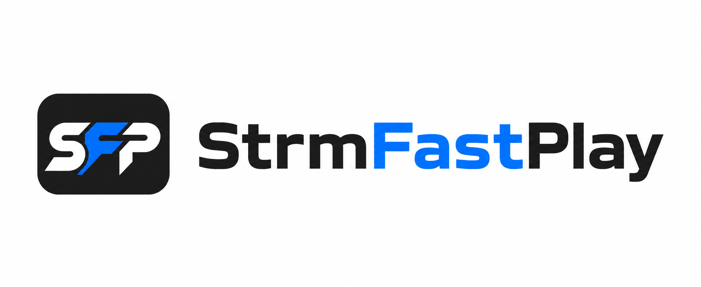

<p align="center">
  
</p>

# StrmFastPlay - Jellyfin STRM / 網盤播放加速插件

**繁體中文** | [简体中文](README.zh-CN.md) | [English](README_EN.md)

**StrmFastPlay 是專為 Jellyfin STRM 播放加速與網盤播放加速設計的插件。**
主要改善 **Jellyfin STRM 起播慢、網盤影片播放前等待時間過長、遠端媒體起播不穩定** 等問題。

適用於透過 OpenList / AList 或其他相容方式提供 STRM、直鏈或 302 播放的遠端媒體來源。

## 主要功能

- Jellyfin STRM 播放加速
- Jellyfin 網盤播放加速
- Jellyfin STRM 起播加速
- 改善點擊播放後等待時間
- 最佳化遠端媒體播放流程
- 支援 OpenList / AList 直鏈與 302 使用情境
- 主要實測 PikPak，並適用其他可正常提供 STRM / 直鏈 / 302 的網盤來源
- 可預先準備下一集，降低連播等待
- Jellyfin 更新時提供 best-effort 相容與安全回退

## 常見網盤使用情境

常見來源包括：

- PikPak
- 夸克網盤
- 迅雷網盤
- 115 網盤
- 123 網盤 / 123 云盘
- 光鴨網盤 / 光鸭网盘 / GuangYaPan
- 阿里雲盤 / 阿里云盘
- 百度網盤 / 百度网盘
- 天翼雲盤 / 天翼云盘
- 中國移動雲盤 / 中国移动云盘
- 中國聯通雲盤 / 中国联通云盘
- UC 網盤 / UC 网盘
- 騰訊微雲 / 腾讯微云
- 藍奏雲 / 蓝奏云
- Google Drive
- OneDrive
- Dropbox
- MEGA
- TeraBox
- Yandex Disk
- FebBox
- Seafile
- Cloudreve
- WebDAV
- SMB

以上僅代表常見適用情境，不等於全部來源都經過完整實測。實際效果取決於來源是否能正常播放、直鏈品質、CDN、網路、字幕與媒體格式。

## FAQ

### Jellyfin 網盤播放很慢怎麼辦？
StrmFastPlay 針對 Jellyfin 遠端 STRM / 網盤播放流程進行最佳化，目標是減少點擊播放後可避免的等待時間。

### Jellyfin 網盤能做到秒播嗎？
來源本身越快、直鏈越穩定，越有機會縮短起播時間。StrmFastPlay 只最佳化 Jellyfin 端流程，不會提升網盤或 CDN 本身的頻寬。

### 支援哪些網盤？
適用於能透過 OpenList / AList 或其他相容方式提供 STRM、直鏈或 302 播放的來源。常見場景包含 PikPak、夸克、迅雷、115、123、光鴨、阿里雲盤、百度網盤、天翼雲盤等。

## 安裝

### Jellyfin 儲存庫安裝（建議）

在 Jellyfin 新增儲存庫時填入：

- 名稱：`StrmFastPlay`
- 儲存庫網址：`https://skillgodak.github.io/StrmFastPlay/manifest.json`

儲存後依序開啟「控制台」→「擴充功能」→「全部」，搜尋 `StrmFastPlay` 並安裝。安裝完成後完整重新啟動 Jellyfin；後續新版本可由 Jellyfin 插件更新功能安裝。

### 手動安裝

[前往 GitHub Releases](https://github.com/SkillGodAk/StrmFastPlay/releases) 下載 `StrmFastPlay.zip`，將 ZIP 內的 DLL 與 `meta.json` 解壓縮到：

```text
jellyfin/config/plugins/StrmFastPlay/
```

Docker 範例：

```text
/volume1/docker/jellyfin/config/plugins/StrmFastPlay/
```

完整重新啟動 Jellyfin 後即可載入。

## 試用與價格

首次安裝可免費試用 7 天。

- 月卡：5 RMB / 台幣 25 元
- 半年卡：25 RMB / 台幣 125 元
- 年卡：50 RMB / 台幣 250 元

聯絡作者：

- QQ 群：`1018495751`
- TG 群：[點此加入](https://t.me/+l1v_7ag4mJQ3NjI1)

## 推廣回饋

發布 StrmFastPlay 推廣介紹文章後，聯絡作者並提供發布證明，可免費獲得一張月卡（1 個月）。

## PikPak 邀請碼

```text
34544273
```
